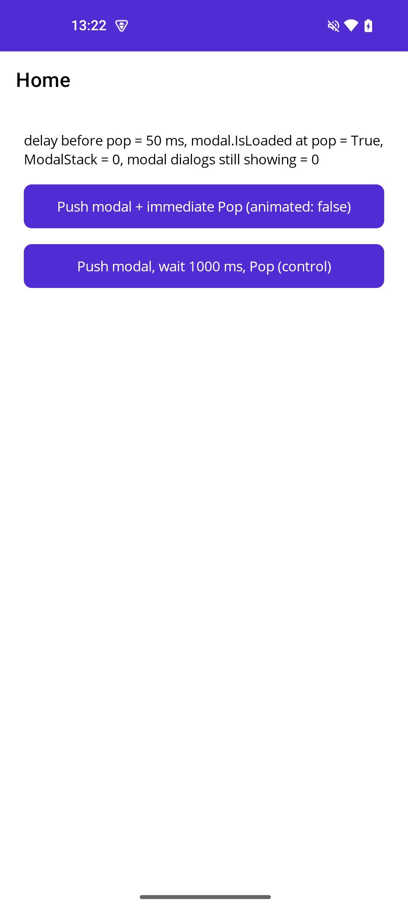
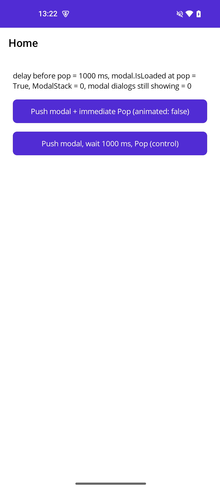
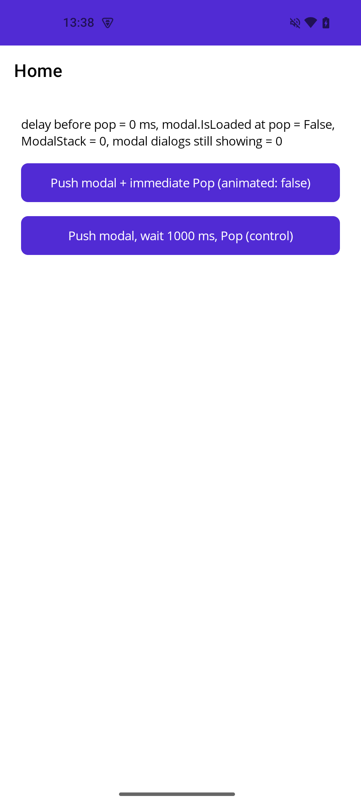
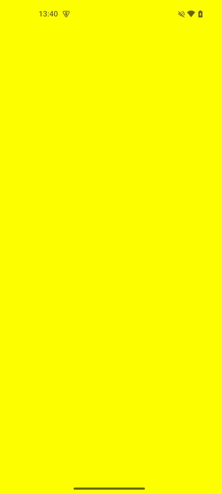

<!--
Issue title (paste into the GitHub title field; the label t/bug is added by the template):
[Android] PopModalAsync right after PushModalAsync(page, animated: false) leaves the modal dialog on screen

Body below follows the fields of https://github.com/dotnet/maui/issues/new?template=bug-report.yml
(Description, Steps to Reproduce, Link to public reproduction project repository, Version with bug,
Is this a regression from previous behavior?, Last version that worked well, Affected platforms,
Affected platform versions, Did you find any workaround?, Relevant log output).
-->

### Description

On Android, when a modal page is popped immediately after it was pushed without animation, the modal is removed from `Navigation.ModalStack`,
but its `ModalFragment` dialog is never dismissed. The app is left with an empty (white) full-screen dialog on top of the app. Back press does nothing
and every later modal page can end up empty as well (the platform modal stack is out of sync with the cross-platform one).

This is a follow-up to #32310 / #32479 (hang when `PopModalAsync` is called right after `PushModalAsync(animated: false)`). That fix makes
`PushModalAsync(animated: false)` wait for `PresentationCompleted` (`ModalFragment.OnResume`), but at that point the modal page is still not
`Loaded` (`IsLoaded == false`, the platform view is not attached to the window yet).

Measurements (Android 15, MAUI 10.0.130; same on 10.0.110):

| delay between Push and Pop | `modal.IsLoaded` at Pop | dialogs still showing after 1.5 s | screenshot after the run |
|---|---|---|---|
| none (`await Push; await Pop`) | `False` | **1** |  |
| 50 ms | `True` | 0 |  |
| 150 ms | `True` | 0 |  |
| 400 ms | `True` | 0 |  |
| 1000 ms | `True` | 0 |  |

Same test with older packages (`await Push; await Pop`, no delay, 3 runs each):

| MAUI | `modal.IsLoaded` at Pop | dialogs still showing | app windows | screenshot after the run |
|---|---|---|---|---|
| 10.0.20 | `False` | 0 | 1 |  |
| 10.0.30 | `False` | **1** | **2** |  |
| 10.0.40 | `False` | **1** | **2** |  |

Animated pushes are not affected (the animation gives the page time to load).

**Analysis** of `ModalNavigationManager.PopModalAsync`:

```csharp
_modalPages.Remove(modal);
...
bool isPlatformReady = IsModalReady;                 // false: modal.IsLoaded == false => IsModalPlatformReady == false
Task popTask = (isPlatformReady && !syncing) ? PopModalPlatformAsync(animated) : Task.CompletedTask;   // platform pop skipped
await popTask;
modal.Parent?.RemoveLogicalChild(modal);             // modal.Handler becomes null right here
...
if (!isPlatformReady)
    SyncModalStackWhenPlatformIsReady();             // deferred sync
```

Observed right after the call returns: `modal.Handler == null`, `modal.Window == null`, `modal.Parent == null`, `modal.IsLoaded == false`
(and it stays `false`), while `_platformModalPages.Count == 1` and the dialog fragment is still added and resumed.

The deferred `SyncModalStackWhenPlatformIsReadyAsync` / `SyncPlatformModalStackAsync` can only run when `IsModalReady` is true, which requires
`CurrentPlatformPage?.Handler is not null && CurrentPlatformPage.IsLoadedOnPlatform()`. `CurrentPlatformPage` is still the popped modal (it is still in
`_platformModalPages`), but its handler was just disconnected by `RemoveLogicalChild`, so the condition can never become true and the platform pop
(`dialogFragment.Dismiss()`) is never executed.

The relevant code is identical in 10.0.110 and 10.0.130 (`ModalNavigationManager.cs` unchanged, `ModalNavigationManager.Android.cs` only adds a check in `ModalFragment.OnCreateView`).

Possible fix: either make `PushModalAsync(animated: false)` also wait until the modal page is `Loaded`, or make the deferred pop independent of the popped page's handler
(e.g. do not disconnect the page / call `RemoveLogicalChild` until the platform pop has actually run, or dismiss the fragment directly when the fragment still exists).

### Steps to Reproduce

1. Clone the reproduction repository (see below) and open `example/ModalRaceRepro.csproj` (new `dotnet new maui` app, Shell template, only `net10.0-android`, `MauiVersion` 10.0.130).
2. Run it on a connected Android device (`./run.sh 0 50 150 400 1000` in the repository root builds, installs and runs it and prints one result line per delay;
   `./run.sh --maui-version 10.0.20 0` builds with another MAUI version),
   or run it from the IDE and tap **Push modal + immediate Pop**. The code that runs:

   ```csharp
   await Navigation.PushModalAsync(new ContentPage { BackgroundColor = Colors.Yellow }, animated: false);
   await Navigation.PopModalAsync(animated: false);
   ```
3. Wait a moment.

Expected outcome: the modal page is closed.

Actual outcome: the yellow modal dialog stays on screen. `Navigation.ModalStack.Count == 0`, but one `DialogFragment` is still showing
(`dumpsys window` lists a second `MainActivity` window of type `APPLICATION`).

### Link to public reproduction project repository

https://github.com/Domik234/Issue-MauiModalPage-PopModalAsyncRightAfterPush-DialogRemains

### Version with bug

10.0.130

### Is this a regression from previous behavior?

Yes, this used to work in .NET MAUI

(Same app, only `MauiVersion` changed, `await Push; await Pop` with no delay on Android 15, 3 runs each: 10.0.20 works every time, 10.0.30 and 10.0.40 leave the dialog on screen every time.
10.0.110 and 10.0.130 behave like 10.0.30/10.0.40. So the behavior changed in 10.0.30, which is the "10.0 SR3" milestone of #32310 / #32479.)

### Last version that worked well

10.0.20

### Affected platforms

Android

(I was *not* able to test on other platforms: the reproduction project targets only `net10.0-android`.)

### Affected platform versions

Android 15 (Nothing Phone A063, physical device); also seen in a larger app on a physical device

### Did you find any workaround?

Wait until the modal page is `Loaded` (or a short delay, >= 50 ms) before popping it:

```csharp
await Navigation.PushModalAsync(modal, false);
while (!modal.IsLoaded) await Task.Delay(10);
await Navigation.PopModalAsync(false);
```

### Relevant log output

```shell
# delay 0 ms
[REPRO] delay before pop = 0 ms, modal.IsLoaded at pop = False, ModalStack = 0, modal dialogs still showing = 1
app windows (dumpsys window): 2

# delay 50 ms
[REPRO] delay before pop = 50 ms, modal.IsLoaded at pop = True, ModalStack = 0, modal dialogs still showing = 0
app windows (dumpsys window): 1

# MAUI 10.0.20, delay 0 ms (works)
[REPRO] delay before pop = 0 ms, modal.IsLoaded at pop = False, ModalStack = 0, modal dialogs still showing = 0
app windows (dumpsys window): 1

# MAUI 10.0.30, delay 0 ms (broken)
[REPRO] delay before pop = 0 ms, modal.IsLoaded at pop = False, ModalStack = 0, modal dialogs still showing = 1
app windows (dumpsys window): 2
```
