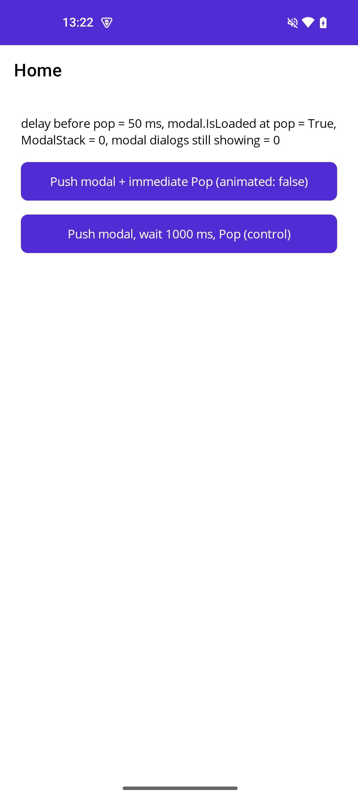
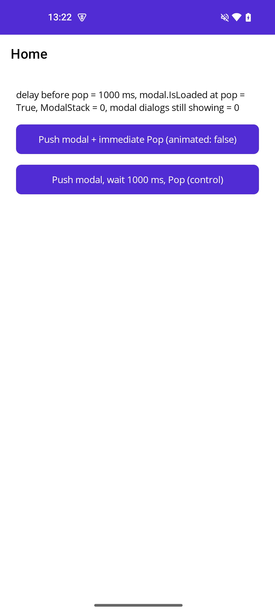
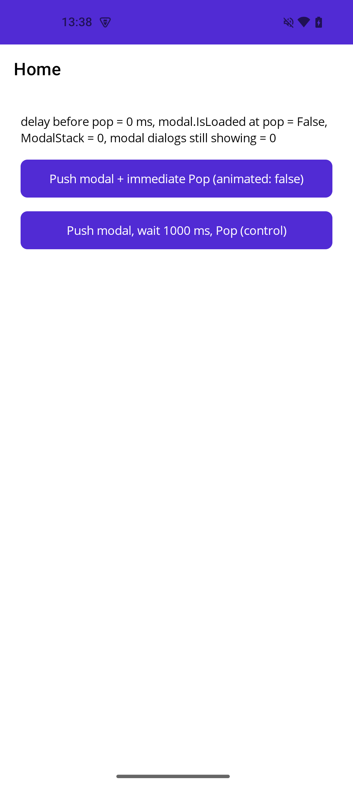
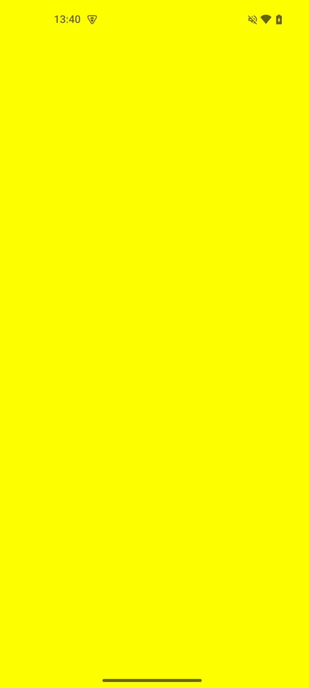

# Modal repro: `PopModalAsync` right after `PushModalAsync(animated: false)` on Android

Minimal .NET MAUI app (new `dotnet new maui` project, Shell template, only `net10.0-android`, MAUI 10.0.130) that pushes a modal page and pops it again.
If the pop comes right after the push, the modal is removed from `Navigation.ModalStack` but its dialog stays on screen. A short delay between the two calls avoids it.

## Repository layout

* [`example/`](example) the MAUI project (`ModalRaceRepro.csproj`)
* [`run.sh`](run.sh) (macOS/Linux) and [`run.ps1`](run.ps1) (Windows PowerShell, also `pwsh`) build, install and run the project on a connected Android device and print the result
* [`results/`](results) screenshot and log line of each run, one folder per device and MAUI version: `NothingA063-Android15/` (Nothing Phone A063, Android 15, MAUI 10.0.130),
  `NothingA063-Android15-MAUI-10.0.20/`, `-10.0.30/`, `-10.0.40/` (same device, delay 0 ms only)
* [`ISSUE.md`](ISSUE.md) draft of the issue for the MAUI repository

## How to run

```
./run.sh                          # builds, installs, runs with 0 ms and 1000 ms between Push and Pop
./run.sh --save results/<dir> 0 50 150 400 1000
./run.sh --maui-version 10.0.20 0 # same, but with another Microsoft.Maui.Controls version than the one in the csproj
```

Run it from the repository root. On Windows use `run.ps1` with the same options in PowerShell style:

```
.\run.ps1                              # 0 ms and 1000 ms
.\run.ps1 -Save results\<dir> 0 50 150 400 1000
.\run.ps1 -MauiVersion 10.0.20 0
.\run.ps1 -SkipBuild 0
```

If PowerShell blocks the script: `powershell -ExecutionPolicy Bypass -File .\run.ps1 0 1000`. `adb` is taken from `PATH`, `ADB` or `%LOCALAPPDATA%\Android\Sdk\platform-tools\adb.exe`.

`run.sh` starts the app with the intent extra `delay_ms`; the app waits 3 s (so the window page is loaded), then pushes a yellow modal page,
waits `delay_ms` and pops it. It logs one line starting with `[REPRO]` and shows it in the status label. The same two runs are available as buttons on the main page.

## Symptom

```csharp
await Navigation.PushModalAsync(modal, false);
await Navigation.PopModalAsync(false);
```

After this the yellow modal dialog stays on screen (the page content is already gone), `Navigation.ModalStack.Count` is 0 and one `DialogFragment` is still showing.
Back press does nothing. `dumpsys window` lists a second `MainActivity` window.

### Nothing Phone A063, Android 15 (physical device), MAUI 10.0.130

| Delay between Push and Pop | `modal.IsLoaded` at Pop | Dialogs still showing | App windows | Screenshot after the run |
|---|---|---|---|---|
| none | `False` | **1** | **2** |  |
| 50 ms | `True` | 0 | 1 |  |
| 150 ms | `True` | 0 | 1 |  |
| 400 ms | `True` | 0 | 1 |  |
| 1000 ms | `True` | 0 | 1 |  |

### Older MAUI versions (same device, no delay between Push and Pop, 3 runs each)

| MAUI | `modal.IsLoaded` at Pop | Dialogs still showing | App windows | Screenshot after the run |
|---|---|---|---|---|
| 10.0.20 | `False` | 0 | 1 |  |
| 10.0.30 | `False` | **1** | **2** |  |
| 10.0.40 | `False` | **1** | **2** |  |

It works on 10.0.20 and is broken from 10.0.30 on (the "10.0 SR3" milestone of dotnet/maui#32310 / #32479). Only the last of the 3 runs is saved as screenshot and log.

Log lines: [`results/NothingA063-Android15/`](results/NothingA063-Android15) (`delay-<ms>ms-log.txt`). The same behaviour was seen with MAUI 10.0.110 and in a larger app (FormsDSH sample, plain `ContentPage`
without any popup).

## Cause (from the MAUI sources and the state of the app after the call)

`ModalNavigationManager.PopModalAsync` (identical in MAUI 10.0.110 and 10.0.130):

```csharp
_modalPages.Remove(modal);
...
bool isPlatformReady = IsModalReady;   // false while modal.IsLoaded == false (IsModalPlatformReady)
Task popTask = (isPlatformReady && !syncing) ? PopModalPlatformAsync(animated) : Task.CompletedTask;   // platform pop skipped
await popTask;
modal.Parent?.RemoveLogicalChild(modal);   // modal.Handler is null from here on
...
if (!isPlatformReady)
    SyncModalStackWhenPlatformIsReady();   // deferred sync
```

Measured right after the call returns (and it does not change afterwards): `modal.Handler == null`, `modal.Window == null`, `modal.Parent == null`, `modal.IsLoaded == false`,
`_platformModalPages.Count == 1`, `_modals.Count == 1`, the dialog fragment is still added and resumed. Before the pop the platform view of the modal is not yet attached to the window
(`IsAttachedToWindow == false`), although `PushModalAsync(false)` has already returned (it waits for `ModalFragment.OnResume`, see dotnet/maui#32479).

The deferred sync (`SyncModalStackWhenPlatformIsReadyAsync` / `SyncPlatformModalStackAsync`) needs `IsModalReady`, which requires `CurrentPlatformPage?.Handler is not null && CurrentPlatformPage.IsLoadedOnPlatform()`.
`CurrentPlatformPage` is still the popped modal, whose handler was just disconnected, so the condition never becomes true and `dialogFragment.Dismiss()` is never called.

## Workaround

Pop the modal only after it is `Loaded`:

```csharp
await Navigation.PushModalAsync(modal, false);
while (!modal.IsLoaded) await Task.Delay(10);
await Navigation.PopModalAsync(false);
```
